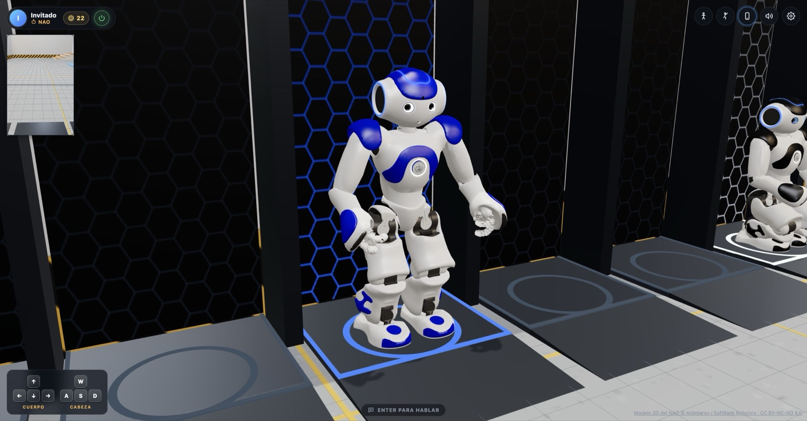
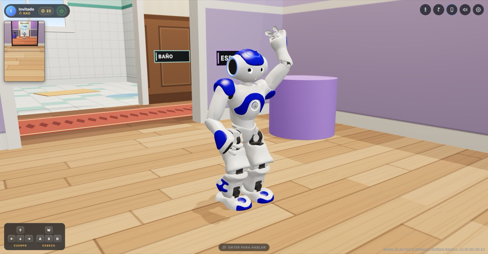
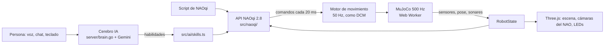

# NAO Web — gemelo digital del robot NAO V6 con IA

**Un NAO V6 completo en el navegador:** física real, la misma API de NAOqi 2.8 que usa el robot físico, y una IA
(Gemini) que lo ve por sus cámaras, lo escucha, le habla y lo mueve con esa misma API.

**▶ Pruébalo:** [nao.bukivo.com](https://nao.bukivo.com) → **Probar demo** (sin cuenta; escritorio o tablet).



Proyecto de grado de **Oscar Javier Castellanos Buelvas** — Fundación Universitaria Los Libertadores (Bogotá, Colombia).

---

## Por qué existe

El plan era reparar un NAO físico y darle IA. En 2025 Aldebaran, su fabricante, entró en quiebra: ya no hay repuestos
ni soporte. El proyecto se convirtió en un **gemelo digital**: un NAO V6 simulado con la mayor fidelidad posible, para
que estudiantes y profesores sigan programando el robot (y lo que escriban aquí funcione en un NAO real).

El sistema operativo del NAO (NAOqi) es **código cerrado**. Lo que sí es público es su documentación y el modelo
cinemático (URDF). Por eso la regla del proyecto es: **la lógica del NAO es la API pública documentada, no un invento
propio**. Mismos servicios, métodos, parámetros, unidades y semántica; todo número sale de una fuente oficial y lo
que no está documentado se marca en el código como `// APPROX:` con su justificación.

## Qué hace

- **25 motores simulados con física real** (MuJoCo en WebAssembly, dentro de un Web Worker): masas e inercias
  oficiales, motores con la curva de torque de las hojas de datos, colisión con la forma real de cada pieza. El NAO se
  cae de verdad y **se levanta solo** usando el grafo de posturas original de NAOqi 2.8 (168 posturas, 295 tramos),
  en las 6 direcciones de caída probadas.
- **API de NAOqi 2.8 reimplementada:** `ALMotion` (articulaciones, interpolación, marcha `moveTo`/`moveToward`,
  cartesiano con IK), `ALRobotPosture`, `ALTextToSpeech`, `ALLeds` (89 LED), `ALVideoDevice` (sus dos cámaras, 17
  espacios de color), `ALMemory`, `ALSonar` con marcha segura, `ALFaceDetection`, `ALBasicAwareness`,
  `ALSoundLocalization`… Un script del robot real corre igual:

  ```js
  const motion = nao.session.service('ALMotion');
  await motion.wakeUp();
  await motion.angleInterpolation('HeadYaw', [1, -1, 0], [1, 2, 3], true);
  await nao.session.service('ALRobotPosture').goToPosture('Sit', 0.8);
  ```

- **Cerebro con IA** (Gemini con *function calling*): conversa por voz o chat, mira por las cámaras del NAO y encadena
  habilidades construidas sobre la misma API (caminar, acercarse a un objeto que ve, empujar, mover los brazos con
  IK…). En la **prueba del espejo**, con un método para comprobarlo (moverse y ver si el otro se mueve igual), se
  reconoce en 4 de 4 ensayos.
- **Voz en el navegador** (Kokoro-82M en WebGPU/WASM) con fonemizador propio para español y los efectos de voz que
  define la documentación de `ALTextToSpeech`.
- **Mundo compartido:** varios NAO en la misma casa; cada navegador simula su robot y comparte su estado por un
  Cloudflare Durable Object a 15 Hz. Se ven, chocan, se oyen y se responden.
- **Teléfono como control** por QR: micrófono con transcripción en vivo, cámara para reconocer rostros (solo con
  permiso de la persona; se guarda la huella numérica, nunca la foto) e inclinación para mover la vista.



## Arquitectura



| Capa | Carpeta | Qué hace |
|---|---|---|
| Modelo | `src/robot/` | URDF → articulaciones, límites, cadenas, cinemática directa, LEDs |
| NAOqi | `src/naoqi/` | Servicios reimplementados y `session.service(name)` al estilo de `qi` |
| Física | `src/physics/` | MJCF generado desde el URDF, motores DC, colisiones, sonares |
| Simulación | `src/sim/` | Escena, mallas oficiales, cámaras del robot, espejo, cámara de juego |
| IA | `src/ai/`, `server/` | Turnos con Gemini, visión, rostros, habilidades |
| UI | `src/ui/`, `src/control/` | HUD estilo juego, ajustes, teléfono por QR |
| Servidor | `server/` | Go: sesiones, cerebro, transcripción, biblioteca con embeddings (pgvector) |
| Mundo | `world/` | Cloudflare Worker + Durable Object de la sala compartida |

**Stack:** TypeScript · Three.js · MuJoCo (WASM) · Web Workers · WebGPU · Vite · Go · PostgreSQL + pgvector ·
Gemini (texto, visión, Live, embeddings) · Cloudflare Workers / Durable Objects · nginx.

## Cómo se valida

Nada se da por bueno sin medirlo. `scripts/bench/` tiene bancos de prueba que se pegan en la consola del navegador y
corren contra el reloj del motor (dan lo mismo a velocidad ×1 que ×10): posturas, marcha (7 metas, error ≤ 8 cm),
las 15 animaciones de Webots, caídas en 8 direcciones y levantarse, la prueba del espejo y el cerebro con IA. Los
parámetros que no publica Aldebaran (por ejemplo, el tiempo de cada tramo para levantarse de espaldas) se ajustaron con
CMA-ES contra un video de un NAO real.

## Correrlo en local

Requisitos: Node 20+, Go 1.26, PostgreSQL 12+ con `citext` y `pgvector`.

```bash
npm install
bash scripts/fetch-nao-meshes.sh       # mallas oficiales (CC BY-NC-ND 4.0, no están en el repo)
bash scripts/fetch-naoqi-postures.sh   # grafo de posturas de NAOqi 2.8 (descarga grande, una vez)
bash scripts/fetch-naoqi-docs.sh       # documentación de NAOqi 2.8 (opcional, referencia)

cp server/.env.example server/.env     # y completa NAO_DB_URL
cd server && go run . migrate && go run . user add yo "Tu nombre" -role admin
GEMINI_API_KEY=… go run .              # nao-api en 127.0.0.1:3030

npm run dev                            # http://localhost:5180 (Vite pasa /api al servidor)
```

Sin `GEMINI_API_KEY` todo funciona menos la IA. Para la cuenta demo: `go run . user add demo "Invitado" -role demo -limit 0.025`.

## Licencia y créditos

El código de este repositorio está bajo la [Licencia Apache 2.0](LICENSE). El material de terceros (URDF, animaciones
de Webots, posturas de qiBullet, NaoTH, MuJoCo, Kokoro…) conserva su licencia; ver [NOTICE](NOTICE).

Las **mallas 3D oficiales del NAO** son © Aldebaran / SoftBank Robotics bajo **CC BY-NC-ND 4.0** (uso no comercial y
sin modificaciones): no se incluyen aquí, se descargan con su script y la aplicación pide aceptar la licencia antes de
cargarlas. Las capturas de este README las muestran tal cual. NAO y NAOqi son marcas de Aldebaran; este es un proyecto
académico, gratuito e independiente.

---

## In English

**NAO Web** is a browser-based digital twin of the NAO V6 humanoid robot, built as an undergraduate thesis after the
manufacturer (Aldebaran) went bankrupt in 2025. It simulates the robot's 25 actuators with MuJoCo physics (WASM, in a
Web Worker) using official masses, inertias and motor curves; reimplements the public **NAOqi 2.8 API** so real NAO
scripts run unchanged; and adds a **Gemini-powered brain** that sees through the robot's cameras, talks, and acts
through that same API (it passes a mirror self-recognition test 4/4 when given a method to check). It also features
in-browser TTS (Kokoro), a multiplayer shared world on Cloudflare Durable Objects, phone control via QR with live
transcription and consent-based face recognition, and a Go + PostgreSQL/pgvector backend.
Try it at [nao.bukivo.com](https://nao.bukivo.com) → *Probar demo*.
